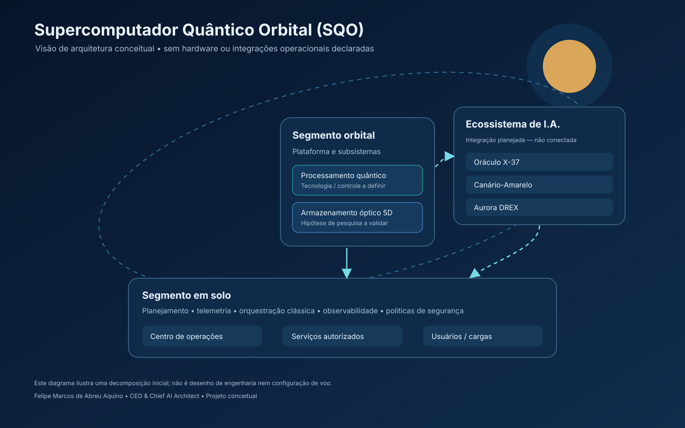

# Supercomputador Quântico Orbital (SQO)

**Uma proposta conceitual de pesquisa e desenvolvimento** sobre computação quântica em ambiente orbital, armazenamento óptico multidimensional e interoperabilidade soberana de inteligência artificial.

> **Maturidade:** conceitual. Este repositório não declara hardware orbital operacional, armazenamento óptico 5D validado, integrações em produção, desempenho medido ou qualificação institucional confirmada.

<p align="center">
  
</p>

## Em poucas palavras

O SQO organiza uma visão inicial para estudar a convergência entre um payload de processamento quântico em órbita, módulos ópticos de armazenamento descritos no escopo como “5D”, serviços de inteligência artificial e infraestrutura de solo. A base atual é documental: os subsistemas, interfaces e requisitos dependem de pesquisa, especificação e validação futura.

| Eixo | Escopo de estudo | Estado neste repositório |
|---|---|---|
| Computação orbital | Payload quântico, controle clássico, operação e ambiente de missão | Conceitual; sem implementação de hardware ou modelo de missão aprovado |
| Armazenamento óptico 5D | Pesquisa de mídia óptica multidimensional | Hipótese; sem mídia, codificação ou dispositivo validados |
| Ecossistema de I.A. | Oráculo X-37, Canário-Amarelo e Aurora DREX | Sistemas citados no briefing; nenhuma integração conectada ou implementada |
| Segmento em solo | Operação, telemetria, orquestração e políticas de segurança | Decomposição preliminar; requisitos em aberto |

## Arquitetura proposta

A arquitetura lógica está dividida em quatro zonas: **segmento orbital**, **payload de computação**, **armazenamento óptico** e **segmento em solo/serviços**. O desenho é ilustrativo — não é um desenho de engenharia, configuração de voo, estudo de missão nem prova da existência de componentes físicos.

- **Processamento quântico orbital:** tecnologia de qubits, controle, instrumentação, correção de erros, rejeição de calor, radiação, potência, massa e enlaces ainda precisam ser comparados e especificados.
- **Armazenamento óptico 5D:** “5D” é o rótulo de uma linha de pesquisa do projeto, não uma especificação estabelecida. Propriedades de codificação, materiais, leitura/gravação, retenção, densidade e resiliência ambiental estão em aberto.
- **Interoperabilidade de I.A.:** o escopo prevê investigar interfaces com Oráculo X-37, Canário-Amarelo e Aurora DREX. API, protocolos, autorização e contratos não foram fornecidos nem implementados aqui.

Mais detalhes e limitações: [Visão Técnica Inicial](docs/technical-overview.md) · [PDF técnico](docs/pdf/sqo-technical-overview.pdf) · [Estado e plano de maturação](docs/PROJECT_STATUS.md).

## Alinhamento institucional declarado

Conforme informação fornecida pelo proponente, o projeto está vinculado à qualificação da **Impulso Digital Soluções em I.A.** no **Catálogo da Indústria Espacial Brasileira da Agência Espacial Brasileira (AEB)**. Esta declaração registra o alinhamento informado, mas **não confirma inclusão, qualificação, aprovação ou endosso pela AEB**. Evidência oficial datada deverá ser adicionada antes de afirmar status institucional confirmado.

## Liderança

**Felipe Marcos de Abreu Aquino** — CEO & Chief AI Architect.

## Organização

```text
.
├── assets/
│   ├── architecture/       # Diagrama vetorial da arquitetura conceitual
│   └── social/             # Recursos visuais conceituais para comunicação
├── docs/
│   ├── pdf/                # Documento técnico em PDF
│   ├── decisions/          # Registros de decisões de arquitetura
│   ├── PROJECT_STATUS.md   # Maturidade, escopo e plano de validação
│   └── technical-overview.md
├── src/
│   ├── integrations/       # Ponto de extensão; sem conectores funcionais
│   ├── optical_storage/    # Pesquisa e protótipos futuros
│   └── processing/         # Pesquisa e protótipos futuros
├── CONTRIBUTING.md
└── SECURITY.md
```

## Como contribuir

Contribuições devem separar **hipótese**, **simulação** e **resultado experimental**, indicar métodos e fontes e deixar limitações explícitas. Leia [CONTRIBUTING.md](CONTRIBUTING.md) antes de abrir uma proposta. Não inclua credenciais, dados sensíveis, informação classificada ou propriedade intelectual sem autorização.

## Segurança e soberania

O repositório é público; publicação de código ou documentação não equivale a avaliação formal de segurança, conformidade, soberania tecnológica ou prontidão de missão. Orientações para reporte responsável estão em [SECURITY.md](SECURITY.md). Não submeta segredos, dados operacionais restritos ou material sujeito a controle de acesso.

## Licença

**Nenhuma licença foi atribuída nesta versão.** Todos os direitos permanecem reservados; a disponibilidade pública não implica permissão de reutilização. Uma licença deverá ser escolhida pelo titular antes de conceder direitos de uso.
